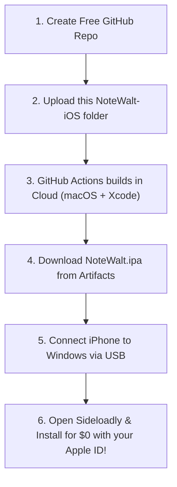

# Note Walt for iOS 🍏📱🔐

Complete Eye-Comfort Note & Digital Wallet Vault configured for iPhone and iPad.
Built with **Capacitor**, **WebCrypto AES-256-GCM**, and automated **GitHub Actions** for 100% free building on Windows without owning a Mac.

---

## 🌟 Key iOS Features

- **CR80 Digital Wallet Cards:** 21 gradient themes, 4 metallic text colors, 5 card fonts, and 3 view modes (Stacked Deck 3D carousel, Grid, List).
- **Vehicle Expense Logger:** Trailing 6-month monthly expense gradient bar chart, auto-calculating fuel volumes, and vehicle setup (Car, Bike, Scooter).
- **EMI Loan Payoff Tracker:** Total commitment & debt metrics, dual charts, and 1-tap "Paid 1 EMI" decrement.
- **Encrypted Passwords Vault:** 18-character cryptographically secure password generator.
- **30-Second Sensitive Clipboard Auto-Clear:** Protects copied card credentials and passwords.
- **Notes Hub:** Interactive checklists with strikethrough, markdown table rendering, and 100 color palettes with WCAG AA contrast assistant.
- **On-Device AES-256-GCM Encryption:** Uses Apple's hardware WebCrypto API for encrypted storage at rest in IndexedDB.
- **iOS Notch & Safe Area Support:** Built-in padding for Dynamic Island, notch, and iOS Home indicator.

---

## 🚀 How to Build & Install on iPhone for FREE (No Mac Needed!)

### Step 1: Create a Free GitHub Repository
1. Go to [github.com](https://github.com) and log in (or create a free account).
2. Click **New Repository**, name it `NoteWalt-iOS` (you can choose **Private** or **Public**), and click **Create repository**.
3. Upload all the files inside this `NoteWalt-iOS` directory (including the `.github/` folder and `www/`).
   *(Tip: You can drag and drop the folder contents directly into the GitHub web interface or use GitHub Desktop)*.

### Step 2: Automatic Cloud Build via GitHub Actions
1. Once uploaded, click on the **Actions** tab in your GitHub repository.
2. You will see the **Build Note Walt iOS (.ipa)** workflow running automatically on a free Apple Silicon Mac!
3. It takes about 2 to 3 minutes to compile.
4. When finished with a green checkmark, click on the completed run.
5. Under **Artifacts** at the bottom, click **NoteWalt-iOS-Build** to download your `NoteWalt.ipa` file to your Windows PC!

### Step 3: Install onto your iPhone via Sideloadly (Free on Windows)
1. Download and install **Sideloadly** (Free Windows app) from [sideloadly.io](https://sideloadly.io).
2. Plug your iPhone into your Windows PC using your USB cable.
3. Open Sideloadly:
   - Your connected iPhone will appear under **Device**.
   - Drag and drop your downloaded **`NoteWalt.ipa`** into the Sideloadly window.
   - Enter your personal **Apple ID email** (no paid account needed).
   - Click **Start**.
4. In ~60 seconds, Note Walt will appear directly on your iPhone Home Screen!
5. **First-time launch on iPhone:**
   - Go to iPhone **Settings > General > VPN & Device Management**.
   - Tap your Apple ID and select **Trust**.
   - Open **Note Walt** and enjoy your app!

---

## 💻 Test in Browser on Windows Right Now
You can also test the mobile interface right on your Windows PC anytime:
Double-click `www\index.html` to open it in Chrome or Edge, press `F12`, and toggle the Mobile Device toolbar (iPhone 14/15/16 preview).
